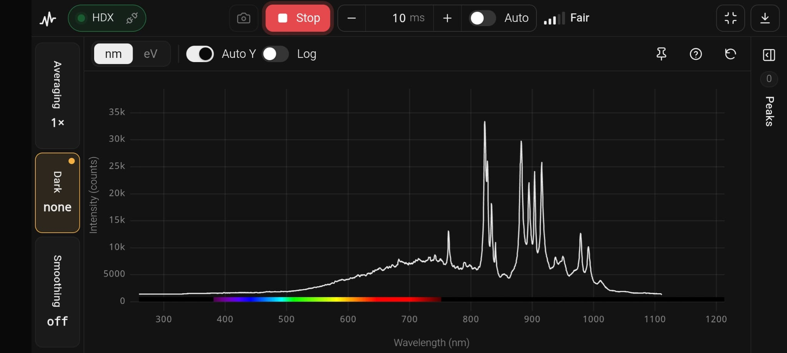

# Spektra

Spektra is browser-based acquisition and analysis software for Ocean Insight spectrometers. It runs as a web
page and communicates with the instrument directly over USB, using its own implementation of the instrument's
protocol. It is tested on the HDX; support for other models is being added and needs test reports ([Supported
instruments](#supported-instruments)). No software has to be installed, and the same page works on Windows,
macOS, Linux, ChromeOS and Android devices.

Application: <https://berameric.github.io/spektra/> · Version 2.0.0 ([changelog](CHANGELOG.md)) ·
[MIT licence](LICENSE)


*Figure 1. Spektra on a computer, with simulated data.*

## Aims

Laboratory spectrometers are normally operated through the manufacturer's software: an application, a USB
driver and often a programming library, installed on a particular computer and supported on particular
operating systems. The measurement thereby depends on software that cannot be inspected, whose processing of
the data is not documented in full, and which ties the instrument to the computers where it is installed.

Spektra is an attempt to remove that dependence. Its aims are:

1. **Independence from vendor software.** The instrument's communication protocol is implemented openly and
   documented ([docs/PROTOCOL.md](docs/PROTOCOL.md)), so that an instrument can be operated, and its behaviour
   examined, without the manufacturer's application, driver or library.
2. **Transparent data processing.** The analysis (baseline, peak position, width and area, energy conversion)
   is described in [Data analysis](#data-analysis) and tested against reference cases, and exported files
   record the acquisition settings (integration time, averaging, smoothing, dark subtraction).
3. **Access without installation.** The software runs in a web browser on any common operating system,
   including mobile devices, so that a measurement can be made wherever the instrument is taken, for teaching
   and fieldwork as well as in the laboratory. (Windows and Linux need a one-time permission step for USB
   access; see [Platform requirements](#platform-requirements).)
4. **Openness and extensibility.** The source is released under the MIT licence with no build step and no
   dependencies, so it can be read, verified, adapted and extended to further instruments
   ([Supported instruments](#supported-instruments)).

Spektra can be used from the published page, <https://berameric.github.io/spektra/>, where nothing is installed
and measurements remain in the browser until exported; or the repository can be downloaded and served locally
(`npm start` or any static web server), for example on a computer without internet access.

## Getting started

1. Open <https://berameric.github.io/spektra/> in Google Chrome or Microsoft Edge.
2. Connect the spectrometer and press **Connect**; select the instrument in the browser's device dialog.
3. Press **Live** for continuous acquisition or **Acquire** for a single spectrum.

On first start, Spektra checks the operating system and browser and lists any preparation still required
(see [Platform requirements](#platform-requirements)).

If the instrument does not connect, see [Troubleshooting](docs/TROUBLESHOOTING.md).

## Features

| | |
|---|---|
| Acquisition | Single and continuous acquisition; integration time 6 ms – 10 s, set manually or automatically; averaging; dark-background measurement and subtraction; boxcar smoothing |
| Signal level | Highest count as a fraction of full scale (Low, Fair, Good, High, Saturated); saturation limit and clipped pixels marked on the plot |
| Peak analysis | Automatic detection over the whole spectrum or a selected range; sub-pixel position, FWHM, height, area and signal-to-noise ratio |
| Axes | Wavelength (nm) or photon energy (eV), the latter with Jacobian conversion to counts per meV; linear or logarithmic intensity |
| Plot | Zoom and pan by mouse, wheel or touch; range selection; reference spectrum for comparison; overview of the full range when zoomed |
| Export | Spectrum and peak table as CSV with acquisition metadata; plot as PNG; peak table to the clipboard |

## Supported instruments

Spektra recognises an Ocean Insight instrument by its USB IDs and selects the driver from a table of per-model
profiles ([`src/device/profiles.js`](src/device/profiles.js)); nothing has to be set by hand.

| Status | Models | |
|---|---|---|
| Tested | HDX | Verified on the instrument with Spektra |
| Experimental, test reports wanted | STS, QE Pro, Spark, Ventana | Same protocol as the HDX; settings taken from python-seabreeze, not yet confirmed on an instrument ([#8](https://github.com/berameric/spektra/issues/8)) |
| Recognised, driver planned | USB2000, USB2000+, USB4000, Flame-S, Flame-T, HR2000, HR2000+, HR4000, USB650, QE65000, NIRQuest, Maya2000, Maya2000 Pro, Maya LSL, Torus, Apex, Jaz, ADC1000-USB | Older command set; a driver is in preparation ([#9](https://github.com/berameric/spektra/issues/9)) |
| Recognised, not yet supported | Ocean ST, SR2, SR4, SR6, HR2, HR4, HR6 | Newer protocol without public documentation ([#11](https://github.com/berameric/spektra/issues/11)) |

Spektra sends nothing to an instrument it cannot operate: for those it shows a report built from the USB
descriptors alone and offers to open a pre-filled GitHub issue. Only for an unknown device that may use the
same protocol as the HDX can you choose to add a few read-only requests to the report.

**Help wanted.** We have only the HDX, so every other model depends on people who own one. If you have any of
the instruments above, open Spektra, connect it and file an
[instrument report](https://github.com/berameric/spektra/issues/new?template=instrument_report.yml): it takes a
few minutes and nothing is written to the instrument. A report is what moves a model from *experimental* to
*tested*. See also [CONTRIBUTING.md](CONTRIBUTING.md).

## Use on mobile devices

On Android, the HDX is connected through a USB-C (OTG) adapter and Spektra runs in Chrome in landscape
orientation; the HDX is powered from its own supply. Figure 2 shows a measurement made in this way.



*Figure 2. Spektra on an Android phone, acquiring a lamp spectrum from an HDX.*

## Platform requirements

| Platform | Requirement |
|---|---|
| macOS, ChromeOS | None |
| Windows | WinUSB driver for the spectrometer, installed once per computer |
| Linux | udev rule granting access to the spectrometer, added once per computer |
| Android | Chrome and a USB-C (OTG) adapter |
| iOS, iPadOS | Not supported; no browser on these systems provides WebUSB |

<details>
<summary>Windows: installing the WinUSB driver</summary>

1. Connect the spectrometer and run [Zadig](https://zadig.akeo.ie).
2. Choose **Options → List All Devices** and select the spectrometer (the HDX has USB ID `2457 2003`).
3. Select **WinUSB** and press **Replace Driver**.

OceanView no longer recognises the instrument afterwards. To revert, uninstall the device in Device Manager and
reconnect it.
</details>

<details>
<summary>Linux: granting USB access</summary>

```bash
echo 'SUBSYSTEM=="usb", ATTR{idVendor}=="2457", ATTR{idProduct}=="2003", MODE="0666"' \
  | sudo tee /etc/udev/rules.d/99-ocean-hdx.rules
sudo udevadm control --reload-rules && sudo udevadm trigger
```

The rule is for the HDX; for another model, use its product ID or leave `ATTR{idProduct}` out. Reconnect the
instrument afterwards. If Chromium is installed as a Snap package, also run `sudo snap connect chromium:raw-usb`.
</details>

Spektra requires the [WebUSB API](https://developer.mozilla.org/en-US/docs/Web/API/WebUSB_API) and a secure
context (`https://` or `http://localhost`). WebUSB is available in Chrome 61+ (desktop and Android), Edge 79+
and Opera 48+; it is not available in Firefox or Safari.

## Instrument communication

Spektra does not depend on the manufacturer's driver, SDK or application software. The HDX and the other
experimental models are controlled with the Ocean Binary Protocol (OBP), a framed binary message protocol
carried over USB bulk transfers, which Spektra implements in JavaScript ([`src/device/`](src/device/)). The
implementation reads the serial number and the wavelength calibration stored in the instrument, sets the
integration time and acquires spectra (on the HDX, 16-bit spectra of 2 068 pixels). Because over some USB
connections (for example through a hub) the instrument occasionally loses or repeats a reply, replies are
matched to requests by message type and requests are repeated after a timeout.

The message format, the messages used, the request–reply handling and the steps needed to support another
instrument are documented in [docs/PROTOCOL.md](docs/PROTOCOL.md).

## Data analysis

The analysis ([`src/analysis/peaks.js`](src/analysis/peaks.js)) is independent of the user interface and is
tested in Node.

1. Baseline and noise are estimated from the lowest 30 % of the pixel values: the baseline as their median,
   the noise σ as 1.4826 times their median absolute deviation.
2. Peaks are local maxima of the baseline-corrected, median-filtered signal whose height and prominence both
   exceed 5 σ and 1 % of the strongest line in the searched range, with a minimum separation of 2 nm.
3. The peak position is refined to sub-pixel precision with a parabola through the logarithm of the three
   highest samples, which is exact for a Gaussian profile.
4. The FWHM is obtained from the interpolated half-maximum crossings; the area by trapezoidal integration
   within ±1.5 FWHM of the centre.
5. Photon energy is E = hc/λ with hc = 1239.841 984 eV·nm (CODATA 2018). On the energy axis, intensities are
   converted from counts per pixel to counts per meV (the Jacobian |dλ/dE| = λ²/hc applied to each pixel width),
   so that the position and shape of broad bands are not distorted.

## Implementation

Spektra consists of plain JavaScript modules served as static files. There is no build step and no dependency
other than the vendored [uPlot](https://github.com/leeoniya/uPlot) plotting library; the repository root is the
website. Nothing is sent over the network: measurements remain in the browser until exported.

## Development

```bash
npm start    # serves http://localhost:8000 without caching
npm test     # Node 18 or newer; no packages to install
```

Without an instrument, <http://localhost:8000/?mock> replaces the USB device with a simulated HDX (available on
localhost only). Conventions for contributors, including AI coding assistants, are given in [AGENTS.md](AGENTS.md).

## Authors and acknowledgements

Spektra was developed by [Bilal Bera Meriç](https://github.com/berameric) at the
[Nano Optoelectronics Laboratories](https://nano-optoelectronics.istanbul.edu.tr/en/_), Istanbul University.
Version 2.0 is the browser successor of an earlier desktop program (1.x).

Plotting uses [uPlot](https://github.com/leeoniya/uPlot) (MIT licence); icons are from
[Lucide](https://lucide.dev) (ISC licence).

## Licence

Spektra is released under the [MIT licence](LICENSE).
