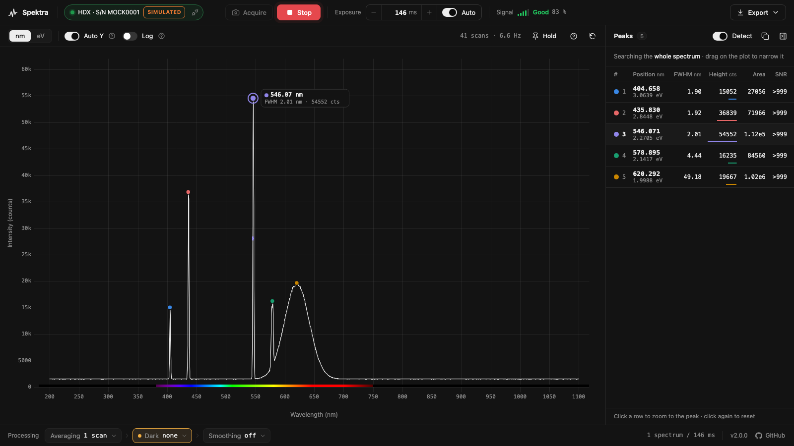

# Spektra

Spektra is browser-based acquisition and analysis software for the Ocean Insight HDX spectrometer. It runs
as a web page and communicates with the instrument directly over USB, using its own implementation of the
instrument's protocol. No software has to be installed, and the same page works on Windows, macOS, Linux,
ChromeOS and Android devices.

Application: <https://berameric.github.io/spektra/> · Version 2.0.0 ([changelog](CHANGELOG.md)) ·
[MIT licence](LICENSE)



*Figure 1. Spektra on a computer, with simulated data.*

## Getting started

1. Open <https://berameric.github.io/spektra/> in Google Chrome or Microsoft Edge.
2. Connect the HDX and press **Connect**; select the instrument in the browser's device dialog.
3. Press **Live** for continuous acquisition or **Acquire** for a single spectrum.

On first start, Spektra checks the operating system and browser and lists any preparation still required
(see [Platform requirements](#platform-requirements)).

## Features

| | |
|---|---|
| Acquisition | Single and continuous acquisition; integration time 6 ms – 10 s, set manually or automatically; averaging; dark-background measurement and subtraction; boxcar smoothing |
| Signal level | Highest count as a fraction of full scale (Low, Fair, Good, High, Saturated); saturation limit and clipped pixels marked on the plot |
| Peak analysis | Automatic detection over the whole spectrum or a selected range; sub-pixel position, FWHM, height, area and signal-to-noise ratio |
| Axes | Wavelength (nm) or photon energy (eV), the latter with Jacobian conversion to counts per meV; linear or logarithmic intensity |
| Plot | Zoom and pan by mouse, wheel or touch; range selection; reference spectrum for comparison; overview of the full range when zoomed |
| Export | Spectrum and peak table as CSV with acquisition metadata; plot as PNG; peak table to the clipboard |

## Use on mobile devices

On Android, the HDX is connected through a USB-C (OTG) adapter and Spektra runs in Chrome in landscape
orientation; the HDX is powered from its own supply. Figure 2 shows a measurement made in this way.


*Figure 2. Spektra on an Android phone, acquiring a lamp spectrum from an HDX.*

## Platform requirements

| Platform | Requirement |
|---|---|
| macOS, ChromeOS | None |
| Windows | WinUSB driver for the HDX, installed once per computer |
| Linux | udev rule granting access to the HDX, added once per computer |
| Android | Chrome and a USB-C (OTG) adapter |
| iOS, iPadOS | Not supported; no browser on these systems provides WebUSB |

<details>
<summary>Windows: installing the WinUSB driver</summary>

1. Connect the HDX and run [Zadig](https://zadig.akeo.ie).
2. Choose **Options → List All Devices** and select the HDX (USB ID `2457 2003`).
3. Select **WinUSB** and press **Replace Driver**.

OceanView no longer recognises the HDX afterwards. To revert, uninstall the device in Device Manager and
reconnect it.
</details>

<details>
<summary>Linux: granting USB access</summary>

```bash
echo 'SUBSYSTEM=="usb", ATTR{idVendor}=="2457", ATTR{idProduct}=="2003", MODE="0666"' \
  | sudo tee /etc/udev/rules.d/99-ocean-hdx.rules
sudo udevadm control --reload-rules && sudo udevadm trigger
```

Reconnect the HDX afterwards. If Chromium is installed as a Snap package, also run
`sudo snap connect chromium:raw-usb`.
</details>

Spektra requires the [WebUSB API](https://developer.mozilla.org/en-US/docs/Web/API/WebUSB_API) and a secure
context (`https://` or `http://localhost`). WebUSB is available in Chrome 61+ (desktop and Android), Edge 79+
and Opera 48+; it is not available in Firefox or Safari.

## Instrument communication

Spektra does not depend on the manufacturer's driver, SDK or application software. The HDX is controlled with
the Ocean Binary Protocol (OBP), a framed binary message protocol carried over USB bulk transfers, which
Spektra implements in JavaScript ([`src/device/`](src/device/)). The implementation reads the
serial number and the wavelength calibration stored in the instrument, sets the integration time and acquires
16-bit spectra of 2 068 pixels. Because over some USB connections (for example through a hub) the
instrument occasionally loses or repeats a reply, replies are matched to requests by message type and requests
are repeated after a timeout.

The message format, the messages used, the request–reply handling and the steps needed to support another
instrument are documented in [docs/PROTOCOL.md](docs/PROTOCOL.md).

## Data analysis

The analysis ([`src/analysis/peaks.js`](src/analysis/peaks.js)) is independent of the user interface and is
tested in Node.

1. Baseline and noise are estimated from the lowest 30 % of the pixel values: the baseline as their median,
   the noise σ as 1.4826 times their median absolute deviation.
2. Peaks are local maxima of the baseline-corrected, median-filtered signal whose height and prominence both
   exceed 5 σ and 1 % of the strongest line in the searched range, with a minimum separation of 2 nm.
3. The peak position is refined to sub-pixel precision with a parabola through the logarithm of the three
   highest samples, which is exact for a Gaussian profile.
4. The FWHM is obtained from the interpolated half-maximum crossings; the area by trapezoidal integration
   within ±1.5 FWHM of the centre.
5. Photon energy is E = hc/λ with hc = 1239.841 984 eV·nm (CODATA 2018). On the energy axis, intensities are
   converted from counts per pixel to counts per meV (the Jacobian |dλ/dE| = λ²/hc applied to each pixel width),
   so that the position and shape of broad bands are not distorted.

## Implementation

Spektra consists of plain JavaScript modules served as static files. There is no build step and no dependency
other than the vendored [uPlot](https://github.com/leeoniya/uPlot) plotting library; the repository root is the
website. Nothing is sent over the network: measurements remain in the browser until exported.

## Other instruments

Spektra recognises an Ocean Insight instrument by its USB IDs and selects the driver from a table of
per-model profiles ([`src/device/profiles.js`](src/device/profiles.js)); no setting has to be entered by hand.
Only the HDX has been tested. The STS, QE Pro, Spark and Ventana, which use the same protocol, are included
as experimental entries (parameters from python-seabreeze) and need confirmation on the instruments. Models
using other protocols (the Ocean ST/SR/HR series and the older single-byte command set) are recognised but
not yet operated; for these, and for unknown Ocean devices, Spektra produces a report from the USB descriptors
and offers to open a pre-filled GitHub issue. Test reports and contributions are welcome; see
[CONTRIBUTING.md](CONTRIBUTING.md) and Section 7 of [docs/PROTOCOL.md](docs/PROTOCOL.md).

## Development

```bash
npm start    # serves http://localhost:8000 without caching
npm test     # Node 18 or newer; no packages to install
```

Without an instrument, <http://localhost:8000/?mock> replaces the USB device with a simulated HDX (available on
localhost only). Conventions for contributors, including AI coding assistants, are given in [AGENTS.md](AGENTS.md).

## Authors and acknowledgements

Spektra was developed by [Bilal Bera Meriç](https://github.com/berameric) at the
[Nano Optoelectronics Laboratories](https://nano-optoelectronics.istanbul.edu.tr/en/_), Istanbul University.
Version 2.0 is the browser successor of an earlier desktop program (1.x).

Plotting uses [uPlot](https://github.com/leeoniya/uPlot) (MIT licence); icons are from
[Lucide](https://lucide.dev) (ISC licence).

## Licence

Spektra is released under the [MIT licence](LICENSE).
